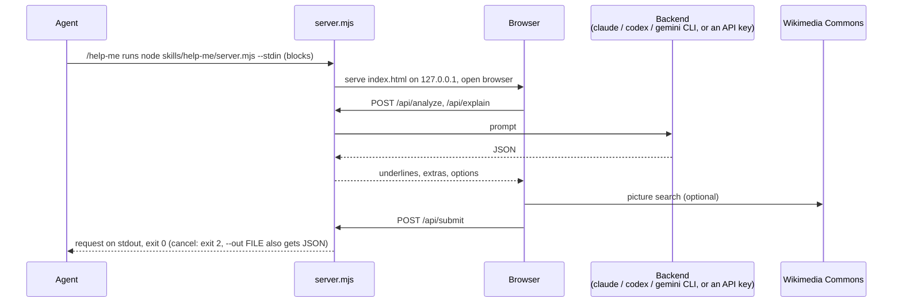

# prompt-shaper

`/help-me` for any coding agent: shape a vague request by clicking on it, then hand it back to the agent.
It's an [Agent Skill](https://agentskills.io), so it works in Claude Code, Codex, Gemini CLI, OpenCode, Cursor
and the other agents that read `SKILL.md`.


`/help-me I want to choose a coffee machine` opens a page with your request on it. A small model underlines every
part you could change. Click one to flip it, or drag a blue value left or right. "Explain me" shows
the options in plain words. Things you haven't said yet, like budget, wait behind an **open questions** button.
Press **Enter** and the shaped request goes back to your agent, a bit like
[plannotator](https://github.com/backnotprop/plannotator) does for plans:

```
Help me choose a bean-to-cup machine for my small kitchen, something good for lattes.

- Budget: up to €850
- Milk: a manual steam wand
```

The underlines come from whichever model you already have: the `claude`, `codex` or `gemini` CLI with your
existing login, or an API key. See [Backends](#backends).

## Install

You need Node 18+ and one [backend](#backends).

**Any agent**, with the [skills CLI](https://github.com/vercel-labs/skills). It finds the agents you have and
installs the skill for each:

```bash
npx skills add baggiponte/prompt-shaper            # this project only
npx skills add baggiponte/prompt-shaper -g         # every project
npx skills add baggiponte/prompt-shaper -g -a codex -a gemini-cli   # pick agents
```

**Claude Code plugin**, which gives `/prompt-shaper:help-me`:

```bash
claude plugin marketplace add baggiponte/prompt-shaper
claude plugin install prompt-shaper@prompt-shaper-local
```

**From a clone**, linked so `git pull` updates it:

```bash
git clone https://github.com/baggiponte/prompt-shaper
bash prompt-shaper/install.sh          # links into ~/.claude, ~/.codex, ~/.gemini, ~/.config/opencode, ~/.agents if present
bash prompt-shaper/install.sh codex    # or just the agents you name
```

| Agent | Skill folder | How to call it |
|---|---|---|
| Claude Code | `~/.claude/skills/` | `/help-me plan a weekend in Lisbon` |
| Codex | `~/.codex/skills/` or `~/.agents/skills/` | `$help-me plan a weekend in Lisbon`, or ask for it by name |
| Gemini CLI | `~/.gemini/skills/` | ask "use help-me to plan a weekend in Lisbon" |
| OpenCode | `~/.config/opencode/skills/` | same |
| Anything else | wherever it reads `SKILL.md` | point it at `skills/help-me/SKILL.md` |

Codex and other sandboxed agents need to let the skill start a local server and open a browser, so approve
that command when asked. If an agent's shell can't wait minutes for a command, the skill tells it to run the
server in the background with `--out FILE` and poll that file instead.

To try the UI on its own, open `skills/help-me/index.html` in a browser. It runs a demo with canned suggestions.

## Usage

```
/help-me plan a relaxed weekend in Lisbon for me and my partner in March, not too expensive
```

| | |
|---|---|
| Click an underline | pick an option, or "Something else" (Alt+↓ opens the one at the caret) |
| Drag a blue value | change a number or amount (arrow keys work too) |
| Explain me | show what each option means and who it suits, with pictures when they help |
| open questions | answer what the request doesn't say yet. **+ More questions** asks for more |
| Type | edit freely. The model reads the text again and keeps what you set |
| Enter / Shift+Enter / ✕ | send / new line / cancel and send nothing |

## How it works



| flag / env | default | |
|---|---|---|
| `--backend` / `PROMPT_SHAPER_BACKEND` | `auto` | see [Backends](#backends) |
| `--model` / `PROMPT_SHAPER_MODEL` | per backend | model for the analysis |
| `PROMPT_SHAPER_EFFORT` | `low` | effort level (claude, codex) |
| `--agent` / `PROMPT_SHAPER_AGENT` | guessed | agent name shown on the page, e.g. "Send to Codex" |
| `--out FILE` | | also write `{"status","prompt"}` to FILE when done |
| `PROMPT_SHAPER_TIMEOUT_MIN` | `30` | give up (exit 3) if nobody answers |
| `--port` / `PROMPT_SHAPER_PORT` | random | fixed port, e.g. for SSH forwarding |
| `--no-open`, `PROMPT_SHAPER_BROWSER` | system opener | don't open a browser, or pick which one |
| `--no-images` / `PROMPT_SHAPER_IMAGES=0` | on | skip the Wikimedia Commons pictures |

## Backends

| `--backend` | Uses | Default model |
|---|---|---|
| `claude` | `claude -p` with your Claude Code login | `haiku` |
| `codex` | `codex exec` with your Codex login, JSON enforced by `--output-schema` | your Codex default |
| `gemini` | `gemini -p` with your Google login | `gemini-2.5-flash` |
| `anthropic` | `ANTHROPIC_API_KEY` (and optional `ANTHROPIC_BASE_URL`) | `claude-haiku-5-5` |
| `openai` | `OPENAI_API_KEY` and/or `OPENAI_BASE_URL`, so OpenRouter, Ollama or LM Studio work too | `gpt-5-mini` |

`auto` (the default) prefers the CLI of the agent that started it, then the first of `claude`, `codex`,
`gemini` on your PATH, then `ANTHROPIC_API_KEY`, then `OPENAI_API_KEY`. Pick a small, fast model: every
edit to the request triggers a new read.

## Notes

- With `claude`, the first read takes about 4 to 9 s and an explanation about 3 s, mostly CLI start-up. API keys are faster.
- Pictures come from a plain Commons search, so they're sometimes off. Hover one for its source page.
- Most agents wait up to 10 minutes for the command. If it times out, run `/help-me` again.
- This is a prototype.
