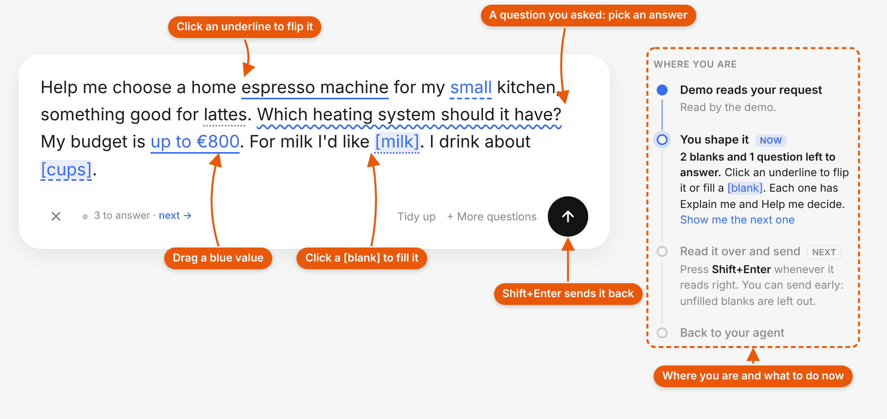
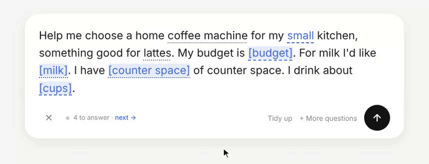
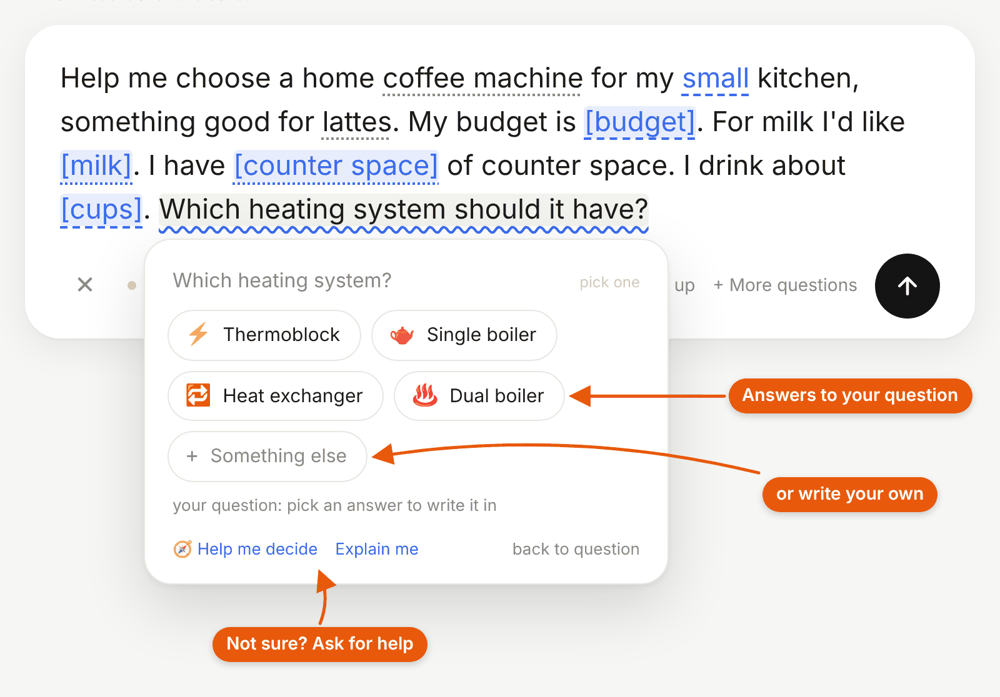
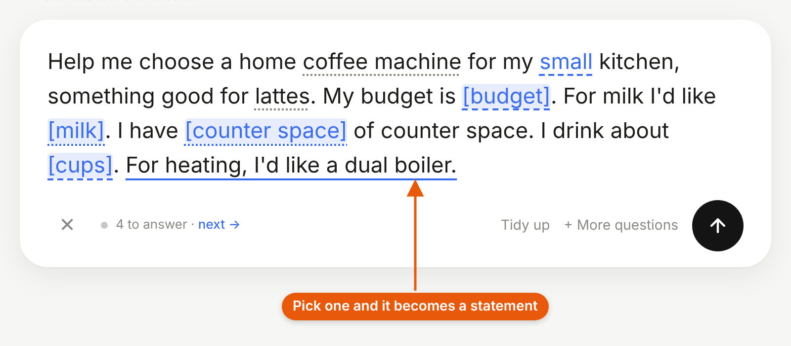
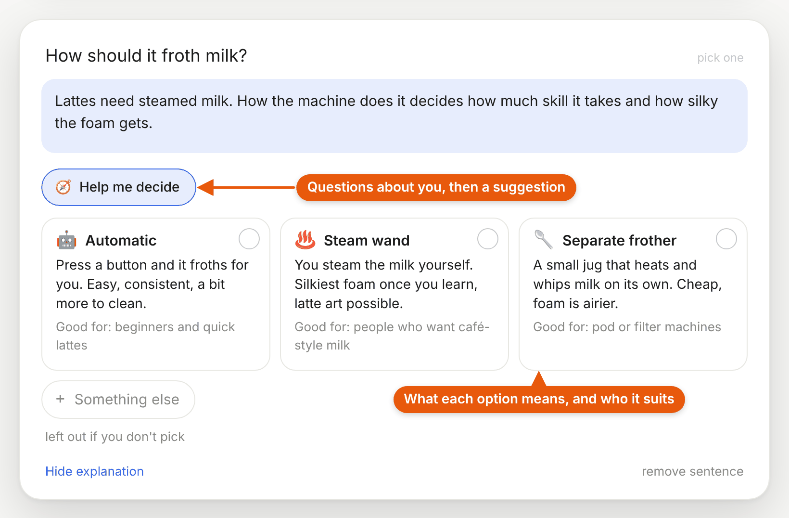
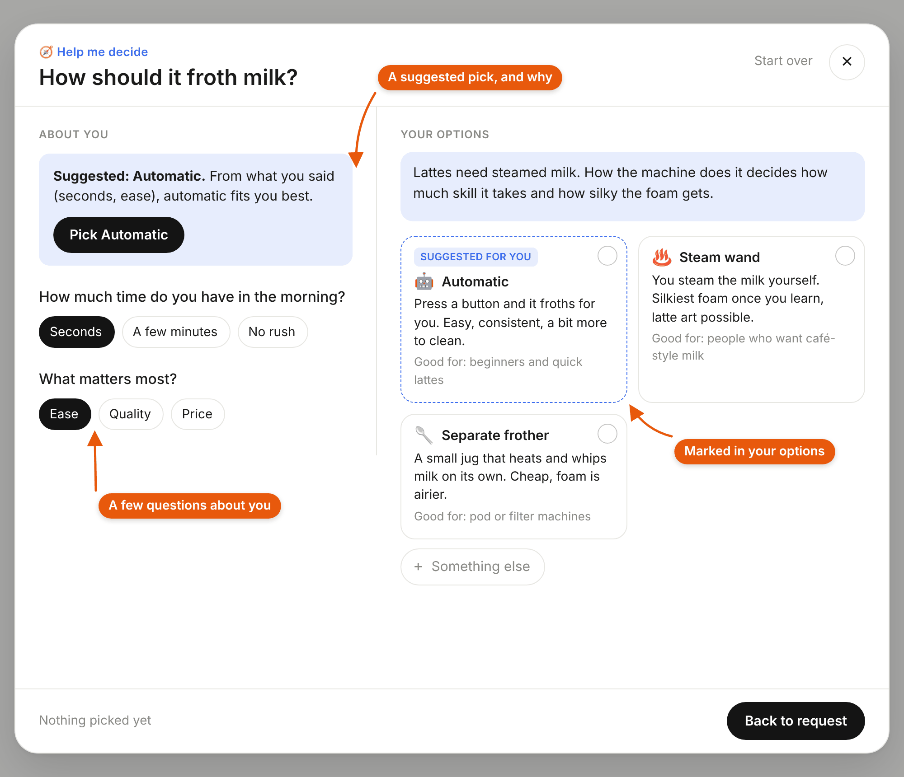
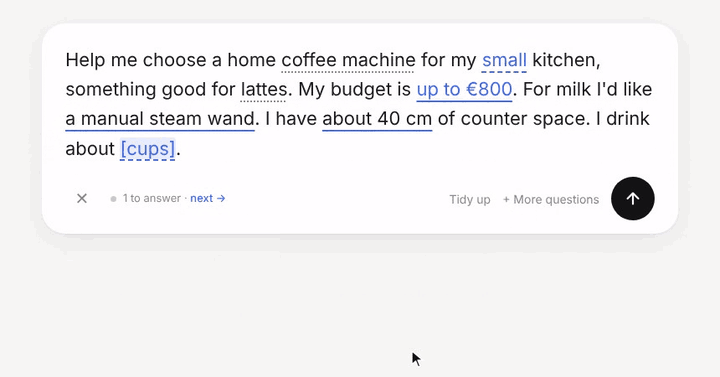
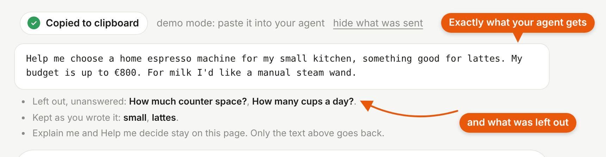

<p align="center">
  
</p>

# 🧭 Chart Room

`/chartroom` for any coding agent: shape a vague request by clicking on it, then hand it back. It's an
[Agent Skill](https://agentskills.io), so it works in Claude Code, Codex, Gemini CLI, OpenCode, Cursor and others.

<p align="center">
  &nbsp;&nbsp;
  &nbsp;&nbsp;
  &nbsp;&nbsp;
  &nbsp;&nbsp;
  <picture><source media="(prefers-color-scheme: dark)" srcset="docs/img/harnesses/opencode-dark.svg" /></picture>&nbsp;&nbsp;
  <picture><source media="(prefers-color-scheme: dark)" srcset="docs/img/harnesses/pi-dark.svg" /></picture>
</p>


`/chartroom I want to choose a coffee machine` opens your request in a page. A small model underlines what you
could change: click to flip it, or drag a blue value. Questions you asked in the request get a wavy underline
and a few answers to pick from. What you haven't said yet becomes a sentence with a blank
("My budget is [budget].") that you click to fill; unfilled ones are dropped. Press **Shift+Enter** and the request
goes back to your agent, like [plannotator](https://github.com/backnotprop/plannotator) does for plans:

```
Help me choose a bean-to-cup machine for my small kitchen, something good for lattes.

- Budget: up to €850
- Milk: a manual steam wand
```

The model is the agent you're already using, on your own subscription: Claude Code, Codex, Gemini CLI, Antigravity,
OpenCode or Pi. Anything else, such as an API key or a local model, is a small plugin. See [Backends](#backends).

## Install

Needs Node 22.18+ (it runs the TypeScript source directly, with nothing to build or install) and one [backend](#backends).

```bash
npx skills add baggiponte/prompt-shaper -g
```

The [skills CLI](https://github.com/vercel-labs/skills) installs it for every agent it finds (drop `-g` for
this project only, add `-a codex` to pick agents). In Claude Code it's `/chartroom ...`; in Codex, `$chartroom ...`;
elsewhere, ask the agent to "use chartroom".

To track `main` instead, clone the repo and symlink `skills/chartroom` into your agent's skills folder
(e.g. `~/.claude/skills/chartroom`). Sandboxed agents such as Codex will ask before the skill starts its local
server and opens a browser: approve it.

### Inside the Claude app

The same page can show up inline in a Claude conversation (desktop and claude.ai) instead of a browser tab, as an
[MCP App](https://modelcontextprotocol.io/extensions/apps). Pressing Send posts the shaped request into the chat as your
message. Clone the repo and install the server's two dependencies (Node 22.18+):

```bash
git clone https://github.com/baggiponte/prompt-shaper chartroom && cd chartroom/mcp && npm install
```

**Claude Desktop**: add it to `~/Library/Application Support/Claude/claude_desktop_config.json`, then restart the app.

```json
{ "mcpServers": { "chartroom": { "command": "node", "args": ["/full/path/to/chartroom/mcp/server.ts"] } } }
```

**claude.ai**: custom connectors are reached from the internet, so run `npm run http` (it listens on
`127.0.0.1:3917/mcp`), expose it with a tunnel such as `cloudflared tunnel --url http://127.0.0.1:3917`, and add
`https://<tunnel>/mcp` in Settings → Connectors → Add custom connector. The tunnel has no login: stop it when you're done.

Then say "/chartroom plan a weekend in Lisbon", or ask to "shape this request in Chart Room". The model reading your request is
still the [backend](#backends) on your machine, picked the same way. In Claude Code's terminal there's nowhere to draw
the page, so keep using the skill there.

## Usage

```
/chartroom plan a relaxed weekend in Lisbon for me and my partner in March, not too expensive
```



Click an underline to pick another option or write your own (Alt+↓ opens the one at the caret). Drag a blue value
left or right to change a number, or use the arrow keys. A `[blank]` is something your request didn't say: fill
it, or leave it and it's dropped when you send; **+ More questions** adds more. Type anywhere and the model reads
the text again, keeping what you set. The timeline says what to do now and **next →** jumps to the next thing
that needs you. **Shift+Enter** sends, Enter adds a line, ✕ cancels.



### Questions you asked

A question in your request ("Which heating system should it have?") gets a wavy underline and concrete answers.
Picking one rewrites it as a statement.

 

### Explain me and Help me decide

**Explain me** opens every option as a card: what it means, who it suits, and a picture when one helps.
**Help me decide** asks a few questions about you and suggests a pick, marked among the options.

 

### Tidy up and rank

Once the request runs long, **Tidy up** reorders your sentences into a short paragraph, **Must-haves** and
**Nice to have**, without changing a word; that layout is what gets sent. Drag the ⋮⋮ grip beside an item to rank
it or move it to the other list (or focus it and press ↑/↓, or Alt+Shift+↑/↓ from the caret). Ctrl/Cmd+Z undoes
moves one at a time, and **Undo tidy** puts the original back until you edit again.



### See what was sent

After you send, the page stays open read-only: **see what was sent** shows exactly what your agent got, and what
was left out.



## Configuration

**Defaults** go in `~/.config/chartroom/config.json` (or under `$XDG_CONFIG_HOME`; `CHARTROOM_CONFIG`
points elsewhere):

```json
{ "backend": "gemini", "images": false }
```

**Per request**, just say it: `/chartroom use codex, no pictures: plan a weekend in Lisbon` shapes "plan a
weekend in Lisbon" with `--backend codex --no-images`.

Flag beats env var beats config file. A config `model` is dropped when the request picks another backend.

| config key   | flag                       | env                     | default       |                                                    |
| ------------ | -------------------------- | ----------------------- | ------------- | -------------------------------------------------- |
| `backend`    | `--backend`                | `CHARTROOM_BACKEND`     | `host`        | see [Backends](#backends)                          |
| `model`      | `--model`                  | `CHARTROOM_MODEL`       | per backend   | model for the analysis                             |
| `effort`     | `--effort`                 | `CHARTROOM_EFFORT`      | `low`         | effort level (claude, codex, antigravity)          |
| `images`     | `--images` / `--no-images` | `CHARTROOM_IMAGES=0`    | `true`        | Wikimedia Commons pictures in "Explain me"         |
| `open`       | `--no-open`                | `CHARTROOM_OPEN=0`      | `true`        | open a browser at all                              |
| `browser`    | `--browser`                | `CHARTROOM_BROWSER`     | system opener | which browser command to use                       |
| `port`       | `--port`                   | `CHARTROOM_PORT`        | random        | fixed port, e.g. for SSH forwarding                |
| `timeoutMin` | `--timeout-min`            | `CHARTROOM_TIMEOUT_MIN` | `30`          | give up (exit 3) if nobody answers                 |
|              | `--agent`                  | `CHARTROOM_AGENT`       | guessed       | agent name on the page, e.g. "Send to Codex"       |
|              | `--out FILE`               |                         |               | also write `{"status","prompt"}` to FILE when done |

For per-agent defaults, set the env vars in that agent's config (e.g. `"env"` in `~/.claude/settings.json`).

## Backends

| `--backend`   | Uses                                                                             | Default model         |
| ------------- | -------------------------------------------------------------------------------- | --------------------- |
| `claude`      | `claude -p` with your Claude Code login                                          | `haiku`               |
| `codex`       | `codex exec` with your Codex / ChatGPT login, JSON enforced by `--output-schema` | your Codex default    |
| `gemini`      | `gemini -p` with your Google login                                               | `gemini-2.5-flash`    |
| `antigravity` | `agy -p` with your Antigravity login, JSON enforced by `--json-schema`           | your agy default      |
| `opencode`    | `opencode run --pure` with whatever OpenCode is set up to use                    | your OpenCode default |
| `pi`          | `pi -p --no-tools --no-session` with whatever Pi is set up to use                | your Pi default       |

`host` (the default) uses the agent you're calling it from, so it runs on the subscription you're already using, with no API
key. It never picks anything else for you: outside a known agent, or when that agent's CLI isn't there,
Chart Room stops with an error that says what's missing and where to set `backend`, and your agent can offer to fix the
config. Antigravity doesn't say it's the one running Chart Room, so there set `"backend": "antigravity"`. Pick a small, fast model: every edit triggers a new read. For OpenCode and Pi, `--model` takes their own
`provider/model` form.

### Your own backend

A backend is a small module, so you can add one without a pull request here. That is also how to use an API
key (Anthropic, OpenAI, OpenRouter) or a local model: Chart Room ships no HTTP backends. Name it under `plugins` in the
config file (paths are relative to it) and pick it like any other:

```json
{ "backend": "ollama", "plugins": { "ollama": "./ollama.ts" } }
```

Its default export has an optional default `model` and a `run` that answers one question with JSON matching
`schema`. It should stop when `signal` aborts, which happens when a newer edit replaces the question:

```ts
// ~/.config/chartroom/ollama.ts
export default {
  model: "qwen3:4b",
  async run({ system, schema, input, model, signal }) {
    const r = await fetch("http://127.0.0.1:11434/api/chat", {
      method: "POST",
      body: JSON.stringify({
        model,
        stream: false,
        format: schema,
        messages: [
          { role: "system", content: system },
          { role: "user", content: input },
        ],
      }),
      signal,
    });
    const { message } = await r.json();
    return { data: JSON.parse(message.content), model };
  },
};
```

The call also has `effort` and `env`. Return `{ data, model?, ms? }`; Chart Room checks `data` against the schema, so
a wrong shape shows up as an error on the page. For types, `import type { Plugin } from ".../skills/chartroom/plugins.ts"`
and end with `satisfies Plugin`. A plugin with a built-in's name replaces it.

The built-in backends are plugins of the same shape (`skills/chartroom/providers/`), so the optional fields they use
work for yours too: `needs` and `available(env)` make Chart Room stop with a clear error when it can't run, and
`host: { agent, running(env) }` lets `host` pick it when Chart Room runs inside that harness. [`PLUGINS.md`](skills/chartroom/PLUGINS.md) is
the guide for an agent writing one: ask yours to "write a Chart Room plugin for X".

## Development

The skill runs straight from `skills/chartroom/` with nothing to install; the dev tooling is for working on it.

- `skills/chartroom/server.ts` is what `/chartroom` runs: it serves the page, waits for Send and prints the request on
  stdout. `api.ts` lists the routes the page calls, `tasks.ts` and `prompts.ts` what each one asks the model,
  `plugins.ts` the shape every backend has and how a configured one is loaded, `providers/` one file per built-in
  backend, and `settings.ts` which backend runs.
- `mcp/server.ts` serves the same page as an MCP App: `node mcp/server.ts` for stdio, `--http` for `127.0.0.1:3917/mcp`.
- `page/` is the page's source. `pnpm build` bundles it into `skills/chartroom/index.html`, which is committed.
- `docs/shots.ts` and `docs/rec.ts` record the README's images and GIF from demo mode.

```sh
pnpm install
pnpm build                 # after editing page/
pnpm lint && pnpm typecheck && pnpm test:unit && pnpm test
```

`uvx --from prek==0.5.7 prek install` adds a hook that audits `.github/` with [zizmor](https://docs.zizmor.sh) on
commit, at its strictest (`pedantic`, no ignores). CI runs the same audit.

## Notes

- With `claude`, a read takes 4 to 9 s, mostly CLI start-up. A plugin that calls an API directly is faster.
- Pictures come from a plain Commons search, so they're sometimes off.
- Most agents wait up to 10 minutes. If it times out, run `/chartroom` again.
- This is a prototype.

## Credits

Inspired by [research](https://x.com/liu_xingyu/status/2121015724374397183) from [Xingyu Liu](https://x.com/liu_xingyu).
