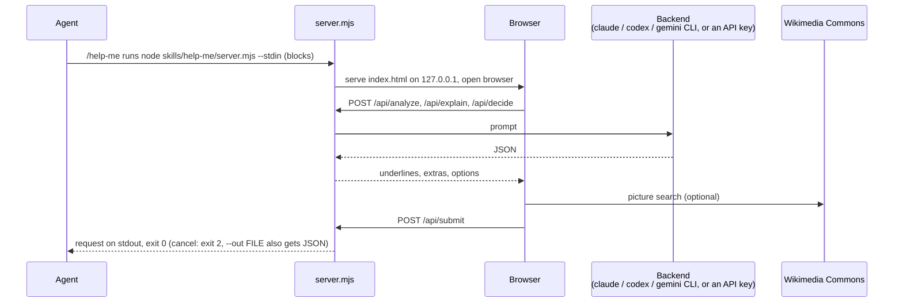

# prompt-shaper

`/help-me` for any coding agent: shape a vague request by clicking on it, then hand it back. It's an
[Agent Skill](https://agentskills.io), so it works in Claude Code, Codex, Gemini CLI, OpenCode, Cursor and others.


`/help-me I want to choose a coffee machine` opens your request in a page. A small model underlines what you
could change: click to flip it, or drag a blue value. Questions you asked in the request get a wavy underline
and a few answers to pick from. What you haven't said yet becomes a sentence with a blank
("My budget is [budget].") that you click to fill; unfilled ones are dropped. Press **Shift+Enter** and the request
goes back to your agent, like [plannotator](https://github.com/backnotprop/plannotator) does for plans:

```
Help me choose a bean-to-cup machine for my small kitchen, something good for lattes.

- Budget: up to €850
- Milk: a manual steam wand
```

The model is whichever you already have: the `claude`, `codex` or `gemini` CLI, or an API key. See [Backends](#backends).

## Install

Needs Node 18+ and one [backend](#backends).

```bash
npx skills add baggiponte/prompt-shaper -g
```

The [skills CLI](https://github.com/vercel-labs/skills) installs it for every agent it finds (drop `-g` for
this project only, add `-a codex` to pick agents). In Claude Code it's `/help-me ...`; in Codex, `$help-me ...`;
elsewhere, ask the agent to "use help-me".

To track `main` instead, clone the repo and symlink `skills/help-me` into your agent's skills folder
(e.g. `~/.claude/skills/help-me`). Sandboxed agents such as Codex will ask before the skill starts its local
server and opens a browser: approve it.

## Usage

```
/help-me plan a relaxed weekend in Lisbon for me and my partner in March, not too expensive
```

| | |
|---|---|
| Click an underline | pick an option, or "Something else" (Alt+↓ opens the one at the caret) |
| Drag a blue value | change a number or amount (arrow keys work too) |
| Explain me | show what each option means and who it suits, with pictures when they help |
| Help me decide | in the Explain me panel: a few questions about you (habits, budget, space) that narrow the options, then a suggested pick |
| Answer a wavy question | a question you wrote ("What do I do with the water heater?") gets concrete answers; picking one rewrites it as a statement ("With the water heater, I'll replace it with a heat pump.") |
| Fill a [blank] | answer what the request didn't say; unfilled sentences are left out when you send. **+ More questions** adds more |
| Tidy up | once the request runs long, the model reorders your sentences into a short paragraph (goal and context), **Must-haves** and **Nice to have**, without changing a word. Underlines and blanks keep working, and that layout is what gets sent. Drag the ⋮⋮ grip beside an item (or focus it and press ↑/↓, or Alt+Shift+↑/↓ from the caret) to rank it or move it to the other list; that order is what gets sent. Ctrl/Cmd+Z undoes moves one at a time, and **Undo tidy** puts the original back until you edit again |
| Type | edit freely. The model reads the text again and keeps what you set |
| Shift+Enter / Enter / ✕ | send / new line / cancel and send nothing |

A "Where you are" timeline on the right (a compact stepper above the request on narrow screens) shows the four
steps: the model reads your request, you shape it, you read it over and send, your agent takes over. It says what to
do now, lists any model call still running (a re-read, Explain me, Help me decide, more questions), and **next →**
jumps to the next blank or question that still needs you.

## How it works



## Configuration

**Defaults** go in `~/.config/prompt-shaper/config.json` (or under `$XDG_CONFIG_HOME`; `PROMPT_SHAPER_CONFIG`
points elsewhere):

```json
{ "backend": "gemini", "images": false }
```

**Per request**, just say it: `/help-me use codex, no pictures: plan a weekend in Lisbon` shapes "plan a
weekend in Lisbon" with `--backend codex --no-images`.

Flag beats env var beats config file. A config `model` is dropped when the request picks another backend.

| config key | flag | env | default | |
|---|---|---|---|---|
| `backend` | `--backend` | `PROMPT_SHAPER_BACKEND` | `auto` | see [Backends](#backends) |
| `model` | `--model` | `PROMPT_SHAPER_MODEL` | per backend | model for the analysis |
| `effort` | `--effort` | `PROMPT_SHAPER_EFFORT` | `low` | effort level (claude, codex) |
| `images` | `--images` / `--no-images` | `PROMPT_SHAPER_IMAGES=0` | `true` | Wikimedia Commons pictures in "Explain me" |
| `open` | `--no-open` | `PROMPT_SHAPER_OPEN=0` | `true` | open a browser at all |
| `browser` | `--browser` | `PROMPT_SHAPER_BROWSER` | system opener | which browser command to use |
| `port` | `--port` | `PROMPT_SHAPER_PORT` | random | fixed port, e.g. for SSH forwarding |
| `timeoutMin` | `--timeout-min` | `PROMPT_SHAPER_TIMEOUT_MIN` | `30` | give up (exit 3) if nobody answers |
| | `--agent` | `PROMPT_SHAPER_AGENT` | guessed | agent name on the page, e.g. "Send to Codex" |
| | `--out FILE` | | | also write `{"status","prompt"}` to FILE when done |

For per-agent defaults, set the env vars in that agent's config (e.g. `"env"` in `~/.claude/settings.json`).

## Backends

| `--backend` | Uses | Default model |
|---|---|---|
| `claude` | `claude -p` with your Claude Code login | `haiku` |
| `codex` | `codex exec` with your Codex login, JSON enforced by `--output-schema` | your Codex default |
| `gemini` | `gemini -p` with your Google login | `gemini-2.5-flash` |
| `anthropic` | `ANTHROPIC_API_KEY` (and optional `ANTHROPIC_BASE_URL`) | `claude-haiku-5-5` |
| `openai` | `OPENAI_API_KEY` and/or `OPENAI_BASE_URL`, so OpenRouter, Ollama or LM Studio work too | `gpt-5-mini` |

`auto` tries the calling agent's CLI, then `claude`, `codex`, `gemini` on your PATH, then `ANTHROPIC_API_KEY`,
then `OPENAI_API_KEY`. Pick a small, fast model: every edit triggers a new read.

## Notes

- With `claude`, a read takes 4 to 9 s, mostly CLI start-up. API keys are faster.
- Pictures come from a plain Commons search, so they're sometimes off.
- Most agents wait up to 10 minutes. If it times out, run `/help-me` again.
- This is a prototype.
