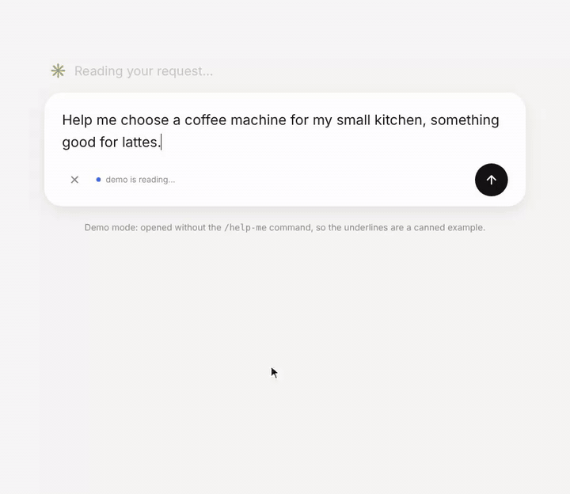
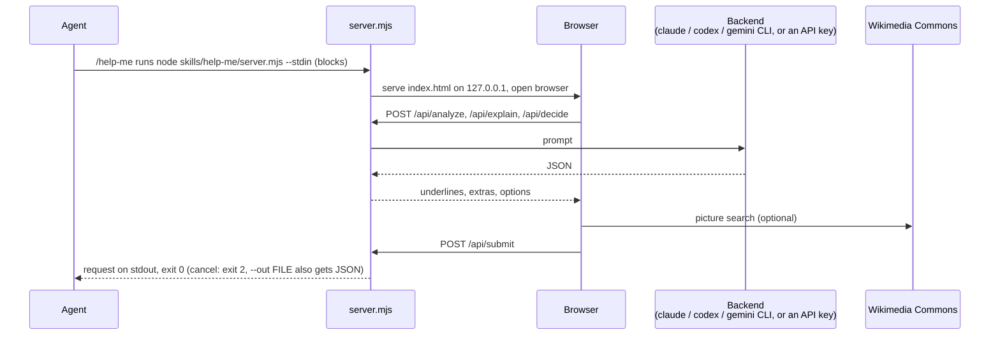

# prompt-shaper

`/help-me` for any coding agent: shape a vague request by clicking on it, then hand it back to the agent.
It's an [Agent Skill](https://agentskills.io), so it works in Claude Code, Codex, Gemini CLI, OpenCode, Cursor
and the other agents that read `SKILL.md`.



`/help-me I want to choose a coffee machine` opens a page with your request on it. A small model underlines every
part you could change. Click one to flip it, or drag a blue value left or right. "Explain me" shows
the options in plain words. Things you haven't said yet, like budget, show up as question cards under the request. Answer one and it
becomes a sentence in the request ("My budget is up to €400.") that you can flip in place like the rest.
Press **Enter** and the shaped request goes back to your agent, a bit like
[plannotator](https://github.com/backnotprop/plannotator) does for plans:

```
Help me choose a bean-to-cup machine for my small kitchen, something good for lattes.

- Budget: up to €850
- Milk: a manual steam wand
```

The underlines come from whichever model you already have: the `claude`, `codex` or `gemini` CLI with your
existing login, or an API key. See [Backends](#backends).

## Install

Needs Node 18+ and one [backend](#backends).

```bash
npx skills add baggiponte/prompt-shaper -g
```

The [skills CLI](https://github.com/vercel-labs/skills) installs it for every agent it finds (drop `-g` for
this project only, add `-a codex` to pick agents). In Claude Code it's `/help-me ...`; in Codex, `$help-me ...`;
elsewhere, ask the agent to "use help-me".

To track `main` instead, clone the repo and symlink `skills/help-me` into your agent's skills folder
(e.g. `~/.claude/skills/help-me`). Sandboxed agents such as Codex will ask before the skill starts its local
server and opens a browser: approve it.

## Usage

```
/help-me plan a relaxed weekend in Lisbon for me and my partner in March, not too expensive
```

| | |
|---|---|
| Click an underline | pick an option, or "Something else" (Alt+↓ opens the one at the caret) |
| Drag a blue value | change a number or amount (arrow keys work too) |
| Explain me | show what each option means and who it suits, with pictures when they help |
| Help me decide | in the Explain me panel: a few questions about you (habits, budget, space) that narrow the options, then a suggested pick |
| Question cards | answer what the request doesn't say yet; the answer is written into the request as a sentence. **+ More questions** asks for more |
| Type | edit freely. The model reads the text again and keeps what you set |
| Enter / Shift+Enter / ✕ | send / new line / cancel and send nothing |

## How it works



## Configuration

Set your defaults once, then override them in the request when you need to.

**Defaults** go in `~/.config/prompt-shaper/config.json` (or `$XDG_CONFIG_HOME/prompt-shaper/config.json`;
`PROMPT_SHAPER_CONFIG` points at another file). Every agent reads the same file:

```json
{ "backend": "gemini", "images": false }
```

**Per request**, just say it. The skill tells the agent to turn phrases about the page into flags and drop
them from the request, so `/help-me use codex, no pictures: plan a weekend in Lisbon` shapes "plan a weekend
in Lisbon" with `--backend codex --no-images`.

A flag beats a `PROMPT_SHAPER_*` env var, which beats the config file, which beats the default. A `model` from
the config file is dropped when the request picks another backend.

| config key | flag | env | default | |
|---|---|---|---|---|
| `backend` | `--backend` | `PROMPT_SHAPER_BACKEND` | `auto` | see [Backends](#backends) |
| `model` | `--model` | `PROMPT_SHAPER_MODEL` | per backend | model for the analysis |
| `effort` | `--effort` | `PROMPT_SHAPER_EFFORT` | `low` | effort level (claude, codex) |
| `images` | `--images` / `--no-images` | `PROMPT_SHAPER_IMAGES=0` | `true` | Wikimedia Commons pictures in "Explain me" |
| `open` | `--no-open` | `PROMPT_SHAPER_OPEN=0` | `true` | open a browser at all |
| `browser` | `--browser` | `PROMPT_SHAPER_BROWSER` | system opener | which browser command to use |
| `port` | `--port` | `PROMPT_SHAPER_PORT` | random | fixed port, e.g. for SSH forwarding |
| `timeoutMin` | `--timeout-min` | `PROMPT_SHAPER_TIMEOUT_MIN` | `30` | give up (exit 3) if nobody answers |
| | `--agent` | `PROMPT_SHAPER_AGENT` | guessed | agent name on the page, e.g. "Send to Codex" |
| | `--out FILE` | | | also write `{"status","prompt"}` to FILE when done |

To give one agent different defaults, set a `PROMPT_SHAPER_*` env var in that agent's own config
(e.g. `"env"` in `~/.claude/settings.json`).

## Backends

| `--backend` | Uses | Default model |
|---|---|---|
| `claude` | `claude -p` with your Claude Code login | `haiku` |
| `codex` | `codex exec` with your Codex login, JSON enforced by `--output-schema` | your Codex default |
| `gemini` | `gemini -p` with your Google login | `gemini-2.5-flash` |
| `anthropic` | `ANTHROPIC_API_KEY` (and optional `ANTHROPIC_BASE_URL`) | `claude-haiku-5-5` |
| `openai` | `OPENAI_API_KEY` and/or `OPENAI_BASE_URL`, so OpenRouter, Ollama or LM Studio work too | `gpt-5-mini` |

`auto` (the default) prefers the CLI of the agent that started it, then the first of `claude`, `codex`,
`gemini` on your PATH, then `ANTHROPIC_API_KEY`, then `OPENAI_API_KEY`. Pick a small, fast model: every
edit to the request triggers a new read.

## Notes

- With `claude`, the first read takes about 4 to 9 s and an explanation about 3 s, mostly CLI start-up. API keys are faster.
- Pictures come from a plain Commons search, so they're sometimes off. Hover one for its source page.
- Most agents wait up to 10 minutes for the command. If it times out, run `/help-me` again.
- This is a prototype.
